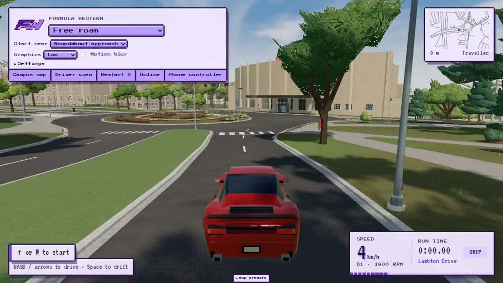
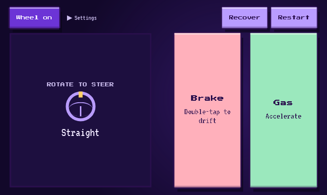

# Formula Western · Drive Western

Drive Western University's campus in London, Ontario. Explore a landmark in free roam, race a right-lane circuit, or turn your phone into the steering wheel for a desktop race. No game account is required. **[Public game](https://fwestern.ca/) · [Where to find the code](#where-to-find-the-code) · [Test on your phone](#test-on-your-phone) · [Campus remodeling](#campus-remodeling) · [Theme and loading screen](#theme-and-loading-screen)**. The public domain and this branch can run different releases.

[](docs/roundabout.mp4)

[Watch the 10-second gameplay clip (MP4)](docs/roundabout.mp4)


Terrain is built from lidar elevation data. Roads, paths, and building outlines come from OpenStreetMap and City of London open data, using 2025 orthophotos and KartaView street-level photos as references. Each campus building is defined by a per-building JSON spec (`build/specs/buildings/*.json`, schema `build/specs/building-spec-v1.schema.json`), compiled by `build/compile_buildings.py`, and generated in the browser by `web/building-*.mjs`.

See the [release handoff and live-site comparison](docs/DRIVING_HANDOFF.md) for the before/after comparison and [UI handoff](docs/UI_HANDOFF.md) for the design implementation.

## Where to find the code

Browse the latest source on [`xingexu/hackwestern` → `main`](https://github.com/xingexu/hackwestern/tree/main). The links below open the implementation on GitHub; links to specific lines are pinned to the documented release so they keep pointing at the right code after edits. Related project: [Drive Western](https://github.com/rohanthmarem/drive-western).

| I want to… | Open this code |
|---|---|
| Start a race | [Enter driving mode](https://github.com/xingexu/hackwestern/blob/09b66cbc31243cc2ba38f59d0025734b69d9f340/web/main.js#L650) → [set up the car, course and camera](https://github.com/xingexu/hackwestern/blob/09b66cbc31243cc2ba38f59d0025734b69d9f340/web/drive.js#L247). |
| Tune drifting and corner assist | [Look ahead for bends](https://github.com/xingexu/hackwestern/blob/09b66cbc31243cc2ba38f59d0025734b69d9f340/web/drive-sim.mjs#L111) · [steering and drift entry](https://github.com/xingexu/hackwestern/blob/09b66cbc31243cc2ba38f59d0025734b69d9f340/web/drive-sim.mjs#L124) · [rear-wheel handbrake torque](https://github.com/xingexu/hackwestern/blob/09b66cbc31243cc2ba38f59d0025734b69d9f340/web/drive-sim.mjs#L247). |
| Change phone controls | [Gas and Brake layout](https://github.com/xingexu/hackwestern/blob/09b66cbc31243cc2ba38f59d0025734b69d9f340/server/pad.html#L129) · [recognize two Brake taps](https://github.com/xingexu/hackwestern/blob/09b66cbc31243cc2ba38f59d0025734b69d9f340/web/phone/pad-wheel.js#L5) · [trigger the drift pulse](https://github.com/xingexu/hackwestern/blob/09b66cbc31243cc2ba38f59d0025734b69d9f340/web/phone/pad-wheel.js#L27) · [turn phone rotation into steering](https://github.com/xingexu/hackwestern/blob/09b66cbc31243cc2ba38f59d0025734b69d9f340/web/phone/pad-wheel.js#L58). |
| Pair a phone on local Wi-Fi | [Start the LAN/HTTPS server](https://github.com/xingexu/hackwestern/blob/main/server/lan.mjs) · [desktop QR and pairing code](https://github.com/xingexu/hackwestern/blob/09b66cbc31243cc2ba38f59d0025734b69d9f340/web/lobby/pair-phone.mjs#L5) · [test the input relay](https://github.com/xingexu/hackwestern/blob/main/server/verify-lan.mjs). |
| Fix a road or turn | [One-way roads and roundabouts](https://github.com/xingexu/hackwestern/blob/09b66cbc31243cc2ba38f59d0025734b69d9f340/build/traffic.py#L39) · [right-lane racing line](https://github.com/xingexu/hackwestern/blob/09b66cbc31243cc2ba38f59d0025734b69d9f340/build/traffic.py#L49) · [enforce turn restrictions](https://github.com/xingexu/hackwestern/blob/09b66cbc31243cc2ba38f59d0025734b69d9f340/build/traffic.py#L104). |
| Restyle the game | [Purple palette and pixel theme](https://github.com/xingexu/hackwestern/blob/09b66cbc31243cc2ba38f59d0025734b69d9f340/web/ui/components.css#L5) · [loader progress and timing](https://github.com/xingexu/hackwestern/blob/09b66cbc31243cc2ba38f59d0025734b69d9f340/web/ui/components.mjs#L16) · [loader exit animation](https://github.com/xingexu/hackwestern/blob/09b66cbc31243cc2ba38f59d0025734b69d9f340/web/ui/components.css#L154) · [driving HUD markup](https://github.com/xingexu/hackwestern/blob/09b66cbc31243cc2ba38f59d0025734b69d9f340/web/index.html#L189). |
| Remodel the campus | [Edit a building’s spec](https://github.com/xingexu/hackwestern/tree/main/build/specs/buildings) → [compile its geometry](https://github.com/xingexu/hackwestern/blob/09b66cbc31243cc2ba38f59d0025734b69d9f340/build/compile_buildings.py#L527) → [render the buildings](https://github.com/xingexu/hackwestern/blob/main/web/campus-buildings.mjs). [Terrain heights](https://github.com/xingexu/hackwestern/blob/main/web/campus-terrain.mjs) and [street furniture](https://github.com/xingexu/hackwestern/blob/main/build/street_detail.py) are separate. |
| Follow an online race | [Lobby and invites](https://github.com/xingexu/hackwestern/tree/main/web/lobby) → [Worker request routing](https://github.com/xingexu/hackwestern/blob/main/server/worker.mjs) → [room state and messages](https://github.com/xingexu/hackwestern/blob/main/server/room.mjs). |

## Requirements & Setup

- Node.js 22+ (Node 24 works) and npm 10+
- Python 3.12+ (3.12 and 3.14 tested)
- The setup scripts use POSIX paths. Run these commands in the game checkout on the computer that will host the race. Native macOS/Linux is simplest for LAN pairing; a container or WSL instance may not expose its own IP to your phone.

```sh
npm run setup
```

This runs `npm ci` and creates `.venv` with `build/requirements.txt`. The Python environment is required because the web build invokes `.venv/bin/python`.

## Running Locally

```sh
npm start
```

Builds and serves the game along with the local Cloudflare Worker via Wrangler (no Cloudflare account required). It prints a Desktop URL and a LAN Phone URL on port 4173.

For front-end work without multiplayer or phone relay:

```sh
npm run dev
```

**Controls:** Arrow keys or WASD to drive, Space to drift, `R` to restart. Choose **Free roam → Start near → Roundabout approach** to practise the entrance. On a circuit or the sprint, driving assists ease the throttle and brake before tight bends; the HUD shows **Bend assist** when active.

## Test on your phone



**First test: use arrows on HTTP.** This checks that the phone can reach the game and trigger a slide without needing sensor permission, a certificate, or a login.

1. Put both devices on the same private Wi-Fi or a personal hotspot that allows connected devices to communicate. On the computer run `npm start` after setup. Leave the terminal running and wait until Wrangler is ready. Do **not** use the Vite-only dev server for pairing.
2. Open the printed **Desktop** address on the computer. On your phone, open the printed **Phone** address in Safari or Chrome. For example, if the computer's Wi-Fi IPv4 is `192.168.1.42`, the phone URL is `http://192.168.1.42:4173/pad`. Substitute **your** address. On a phone, `localhost` means the phone, not the computer.
3. On desktop choose **Phone controller**. Scan its QR (includes the code), or enter the six-character code on the phone and tap **Pair controller**. The desktop dialog closes when connected. The local host and pad must use the **same Worker**; a code from the laptop won't work at fwestern.ca.
4. Lock the phone in portrait while upright, tap **Start driving**, then hold it sideways. On HTTP, use the left/right arrows. Leave the desktop game active. The pad is a remote; **Drive on this device instead** opens the full 3D game on the phone.
5. On desktop choose **Free roam → Start near → Roundabout approach**. Hold **Gas**, build speed, and steer into the bend. Keep Gas down and tap **Brake** twice with your other thumb. The pink pedal briefly reads **Drift** in gold; rear grip drops and the dashboard shows the slide angle if the car actually slips. Straighten or countersteer to recover.
6. Compare with one press: it should slow the car without the gold pulse. Hold Brake at rest to reverse. A double-tap at rest is not a launch. Switch tabs or put the phone down: stale pedal input should not stay held.

**Second test: turn the phone like a wheel.** Use the same HTTPS game origin on both devices and allow motion when prompted by **Start driving**. Hold either landscape grip: turn clockwise for **Right**, counterclockwise for **Left**, level for **Straight**. The rim and angle readout should follow the motion. Wheel settings adjust sensitivity and optional haptics. Arrows and Brake still work without the sensor.

For a **local HTTPS** test, use a certificate for the computer's actual Wi-Fi IP or resolvable LAN hostname that the phone and the computer already trust. Example with [mkcert](https://github.com/FiloSottile/mkcert), on a private development network:

```sh
# Replace the example IP. Keep certificates OUTSIDE the repository.
mkdir -p "$HOME/.formula-western-tls"
mkcert -install
mkcert -cert-file "$HOME/.formula-western-tls/lan.pem" -key-file "$HOME/.formula-western-tls/lan-key.pem" 192.168.1.42
npm start -- --host 192.168.1.42 --https-cert "$HOME/.formula-western-tls/lan.pem" --https-key "$HOME/.formula-western-tls/lan-key.pem"
```

Installing the CA on the laptop does **not** trust it on the phone. For a personal test phone, follow [mkcert's mobile trust instructions](https://github.com/FiloSottile/mkcert#mobile-devices) using **only** the public `rootCA.pem` from `mkcert -CAROOT`; never share either private key. On iOS enable full trust for that certificate. Remove the test CA afterward. If you cannot install a CA, use a trusted HTTPS deployment of the **same release** for wheel testing; keep using HTTP arrows for local drift. Do not bypass certificate warnings.

| Symptom | Check / fix |
|---|---|
| The phone page never loads | On the phone open `http://<computer-Wi-Fi-IP>:4173/api/health`. Expect JSON with `multiplayer: true`. If that fails, it is a reachability problem, not a brake gesture or login problem. |
| Wrong IP in the QR or link | Get the computer's Wi-Fi IPv4 from its network settings. Stop the server, run `npm start -- --host <computer-Wi-Fi-IP>`, reopen the printed Desktop URL, end old pairing and get a new code. VPN and virtual adapters can advertise the wrong address. |
| Computer loads, phone times out | Allow the server's inbound TCP port 4173 on the **private** network only. Check guest/campus client isolation, VPN routing, cellular fallback, and VM/container networking. Try a personal hotspot. Do not disable the entire firewall or open the router to the internet. |
| Phone loads, code fails | Use the current host's exact origin, port and code. End pairing, get a new code, and reopen the phone in its normal browser. A static preview has no relay. |
| Connected, but no wheel motion | “Wheel needs HTTPS” on HTTP is expected. On trusted HTTPS allow motion, check browser/site permissions, tap **Enable wheel steering**, and try both orientations. If blocked, switch to arrows. |
| Wheel turns but no drift | Bring the car up to speed and turn. Each Brake press must be ≤220 ms; start the second within 320 ms of releasing the first. Don't drag off the pedal. A qualifying second release triggers a 410 ms handbrake pulse, not a persistent drift mode. |

## Modes, controls and road rules

| Mode | What to try |
|---|---|
| Campus map / Free roam | Find a landmark, choose a nearby start and explore. The practice start is about 40 m before the roundabout. Traffic messages guide you; they do not lock the wheel. |
| UC Hill Sprint · 562 m | Follow University, Middlesex and Elgin. The shortened finish avoids the restricted Oxford/Kent connection. |
| College Hill · 2,034 m / Stadium · 1,526 m | Follow the checkpoint arrows around the island counterclockwise, keeping it on the left. The arrows trace the lane rather than pointing across the island. |
| Main Campus · 2,682 m | The long circuit uses right-lane geometry and avoids restricted Oxford Drive. It does not traverse the roundabout. |
| Time trial / Online | Race a ghost or share a room code. Circuit grid positions follow the lane behind the start; joining farther back does not count as lap progress. |

WASD/arrows drive, Space applies the handbrake, R restarts. On a standard gamepad use the stick, RT/LT and A for handbrake. On either phone interface **Brake is the only drift trigger**; Gas never doubles as Drift. On sprint and circuits, enabled bend assist eases throttle and brakes before tight corners. The HUD distinguishes **Grip**, **Bend assist**, **Slide entry**, and measured **Drift N°**; the RPM strip changes colour above 6,000 RPM. The countdown, landmark names, minimap, recover action and finish dialog keep the driver oriented.

The compiler checks mapped motor-vehicle access, one-way and reverse-one-way streets, roundabout circulation and turn restrictions. It offsets bidirectional roads to the right and checks curves against surveyed pavement and islands. This is a game based on a map snapshot, **not** navigation or a representation of temporary closures.

## Theme and loading screen

| Surface / role | Exact design values |
|---|---|
| Panels | Translucent lavender `rgb(240 233 255 / 95%)`, solid `#f0e9ff`, inset `#ddd0ff`. |
| Purple family | Purple `#4a1a99`, violet/accent `#6c34d6`, lilac `#a57cf5`. Buttons: rest `#b99cff`, hover `#cdb8ff`, pressed `#9f7ff2`. |
| Contrast | Text and border `#2a0f4d`, secondary text `#5a3c96`; dark layers `#12082a`, `#1d0f3f`, `#2b1760`; cream `#fbf6ea`, mist `#cdbff0`. |
| Feedback | Gold/focus `#ffd166`, mint `#7ef0b0`, error `#ff6b7a`. Phone Gas `#9be8bd`, Brake `#ffb0bb`, pulse gold with `#fff1c9` inset. |
| Type and edges | Locally bundled **Press Start 2P** for labels/buttons and **VT323** for copy/numbers. One design pixel is 3 CSS px: square notched edges, inset highlight and a hard shadow 6 px right / 9 px down. |

The desktop course controls wrap inside a compact panel so the central checkpoint arrow stays clear. Touch screens keep speed, time and traction on one strip under 30 px high; the map and driving menu can expand without shrinking the pedal targets.

**What appears, in order:**

1. A dark ink gradient with violet glow and six pixel stars appears before the scene. The pixel logo pops in over 500 ms (6 steps), then bobs every 1.2 s (2 steps). On the 42 px road, gold dashes scroll every 600 ms (6 steps) behind a 16×6-pixel car bobbing every 300 ms. One play tip is chosen per load; short screens hide it.
2. The meter shows 20 blocks, five percentage points each. Asset completions drive it up to 70%; “Preparing” eases toward 95%. It is an estimate, not a byte counter or fixed-duration intro. The status underscore blinks once per second.
3. When the scene reports ready, the meter reaches 100%. The percentage blinks (250 ms, twice); after 260 ms the loader starts its upward 550 ms, 8-step exit. It is hidden 700 ms after exit starts, not deleted. HUD cards slide in as the loader leaves.
4. A load error stops the animation, hides the road, turns status and meter red, and offers **Retry**. Reduced motion skips the wait and wipe. Same-page mode navigation normally has a stepped wipe; course/spawn changes and restarts use a checker flash. Reduced-motion players still see the countdown and landmark names.

Keep [shared styles](web/ui/components.css), [loader logic](web/ui/components.mjs) and the [standalone phone theme](server/pad.html) together when restyling; the Worker pad does not inherit the desktop CSS.

## Campus remodeling

**What changed in this release:** the sprint, three circuit lines, legal spawn positions, lane arrows and traffic feedback were rebuilt. Buildings, bridges and terrain below are the underlying campus reconstruction, **not** newly surveyed buildings in this driving patch. They determine what the car sees and which ground, wall or deck it contacts.

| Layer | How the model is made | Where to inspect it |
|---|---|---|
| Terrain and river | LiDAR-derived ground heights drive the core and regional terrain; separate water, banks and bridge decks preserve elevations across the Thames. | [Region](web/campus-region.json), [terrain sampler](web/campus-terrain.mjs), [bridge checks](web/dev/verify_bridges.mjs) |
| Building massing | Survey footprints and roof heights establish the base volumes. Per-building specs describe floors, materials, wall bays, roof forms and entrances; the compiler resolves parts and openings for runtime geometry and contacts. | [Authored specs](build/specs/buildings), [compiler](build/compile_buildings.py), [renderer](web/campus-buildings.mjs), [contact shapes](web/building-contacts.mjs) |
| Recognizable facades and landmarks | Registered street imagery informs wall positions, materials and relief; dedicated exterior details distinguish University College, Middlesex, Physics, Natural Sciences and McIntosh Gallery from generic blocks. | [Facade pipeline](build/streetview_facades.py), [landmark and street renderer](web/street-detail.js) |
| Pavement and markings | City carriageways and imagery distinguish asphalt from sidewalks, grass, medians, crossings and parking paint. Fixed street furniture uses its survey axis rather than moving when a racing line changes. | [Surface tiles](web/surface-tiles.json), [paint compiler](build/street_finishes.py), [street details](build/street_detail.py) |
| Canopy and objects | Aerial colour and LiDAR canopy measurements inform trees. Municipal lamps, hedges and sidewalks combine with mapped shelters, racks, benches, crossings and signs. | [Canopy survey](build/canopy_survey.py), [municipal detail](build/municipal_detail.py), [signs](build/streetview_signs.py) |
| Playable road network | Directed OSM ways and access/turn checks produce smoothed, pavement-checked lanes. These feed on-screen routes, baked race contacts, the sim version and replay fixtures. | [Traffic rules](build/traffic.py), [sprint](web/drive-route.json), [network](web/drive-network.json), [baked courses](web/race/courses.mjs) |

The client uses Three.js r170 and Vite 8. Driving advances at a fixed simulation step, independent of render frequency. Python generates the geographical assets; the Worker serves the built client, pairing page, race rooms and leaderboard. Keyboard, gamepad, direct touch and paired-phone packets feed the same driving simulation.

## Multiplayer

Rooms support up to 8 players via a 6-character code or invite link. Each client simulates its own car and sends 64-byte state updates at 60 Hz over WebRTC data channels, with a WebSocket fallback through the Worker. Remote cars are extrapolated to the present with error-decay smoothing.

Rooms handle lobby state, ready checks, synced countdowns, race results, reconnects (seats are held for ~20 s), and graceful draining on deploy. Netcode lives in `web/net/`; room logic is in `server/room.mjs`.

## Deployment & Cost

Log in once, then deploy:

```sh
npx wrangler login
npm run deploy
```

This publishes to `https://drive-western.<your-subdomain>.workers.dev`.

- **Multiplayer:** Enabled in the checked-in Worker configuration (`MULTIPLAYER: "1"`).
- **Optional TURN relay (TLS 443):** Set `TURN_URL` (e.g. `turns:relay.example:443?transport=tcp`) along with `TURN_SECRET` (coturn shared secret), or `TURN_USER` and `TURN_PASSWORD`.
- **Existing custom domain:** The checked-in `domain` environment targets fwestern.ca and www.fwestern.ca. An authorized site maintainer runs `npm run deploy:domain` from the intended revision. A GitHub merge or static Vercel preview does not update the phone relay.
- **Verify rollout:** Compare `sim` at [live health](https://fwestern.ca/api/health) with `node --input-type=module -e "import {SIM_VERSION} from './web/race/version.mjs';console.log(SIM_VERSION)"`. Also check the live pad says **Double-tap to drift**: a sim match alone doesn't identify a UI-only change.

This 30-day USD estimate includes the $5 Workers Paid minimum and assumes no other account usage. Over the WebSocket relay, a full eight-player room at 60 updates per second per player generates 86,400 billable Durable Object requests per hour after the 20-to-1 WebSocket discount. With the included quotas and rounded units, eight full rooms at three hours per day cost about $14/month, and eight full rooms running nonstop cost about $117/month. Direct WebRTC packets bypass the relay, and storage and optional TURN can add charges. Figures follow [Cloudflare Durable Objects pricing](https://developers.cloudflare.com/durable-objects/platform/pricing/).

## Building Workflow

Edit a building spec in `build/specs/buildings/<id>.json`, then validate, preview, compile, and verify:

```sh
.venv/bin/python build/validate_specs.py <id>
node web/dev/building_preview.mjs --id <id> --out <dir>
.venv/bin/python build/compile_buildings.py
node web/dev/verify_campus_buildings.mjs
```

`verify_campus_buildings.mjs` enforces LOD triangle budgets: far <120k, mid <850k, near <4.4M.

## Testing & Checks

Project checks are defined in `.agent/agentkit.toml` under `fast` and `full`:

```sh
agentkit verify   # fast checks
npm run verify    # full checks
```

Individual commands from `.agent/agentkit.toml` can also be run directly. Some full checks render building previews under a 20-second render limit and need a quiet machine.

Netcode and server verification:

```sh
node server/test-net.mjs                # unit tests
node server/bench-net.mjs               # full netcode bench (or --quick)
node server/bots.mjs --seconds 140      # load test
node server/verify-online.mjs           # browser journey: online multiplayer
node server/verify-pad.mjs              # browser journey: phone controller
node server/verify-school.mjs           # browser journey: restricted network
```

For the driving and controller release, run these from the repository root:

```sh
npm run build
.venv/bin/python build/test_traffic.py
node web/dev/verify_network.mjs && node web/dev/verify_circuits.mjs
node web/dev/verify_drive_sim.mjs && node web/dev/verify_zones.mjs
node web/dev/verify_replay.mjs && node server/verify-wheel.mjs
node web/dev/verify_mobile_hud.mjs && node web/dev/verify_race_guidance.mjs
node server/verify-pad.mjs
# With npm start running in another terminal, pass the printed Desktop origin:
node server/verify-lan.mjs http://192.168.1.42:4173
```

The LAN check joins both sockets and verifies a Gas + handbrake packet at the host. The pad journey exercises manual entry, QR, normal braking, steering, reconnect and double-tap feedback in emulated browsers. Neither replaces a real handset on the target Wi-Fi. On Linux, browser checks may need `npx playwright install --with-deps chromium firefox webkit`.

## Repository Layout

- `web/` — game client, compiled assets, and dev tools (`web/dev/`)
- `web/net/` — shared netcode
- `web/race/` — deterministic simulation, courses, replays
- `web/lobby/` — room UI and phone pairing
- `server/` — Cloudflare Worker, rooms, relay, tests, benchmarks
- `build/` — Python data pipeline, building specs, validation checks
- `data/` — build inputs
- `.agent/agentkit.toml` — saved check lists

## Excluded Data

About 40 GB of raw/intermediate files are omitted from the repository: `data/streetview` (KartaView photos), `data/audit` (per-cell audit renders), `data/buildings/review`, the raw lidar tiles in `data/buildings/lidar`, and most of `data/buildings/evidence`.

Compiled assets in `web/` and the inputs required to rebuild them (`data/region`, `data/models`, `data/street`, `data/lidar`, `data/buildings/inventory.json`, `data/buildings/lidar/roof-grid.npz`, and each building's `aerial-source.jpg`) are included, so the game builds and runs from a fresh clone.

To regenerate raw inputs:

```sh
.venv/bin/python build/fetch.py                 # OSM and imagery tiles
.venv/bin/python build/streetview_frames.py     # KartaView frames
.venv/bin/python build/building_inventory.py    # inventory.json and per-building evidence
node web/dev/audit/run.mjs --run <name> --stage all --workers 4  # per-cell audit renders
```

## Data Credits

- OpenStreetMap contributors (ODbL)
- City of London open data
- KartaView imagery (CC BY-SA)
- Western University facilities references

Check each source's license before redistributing derived data or assets.
